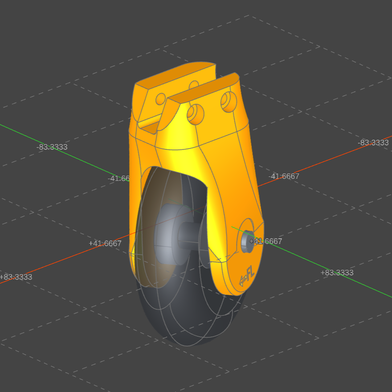
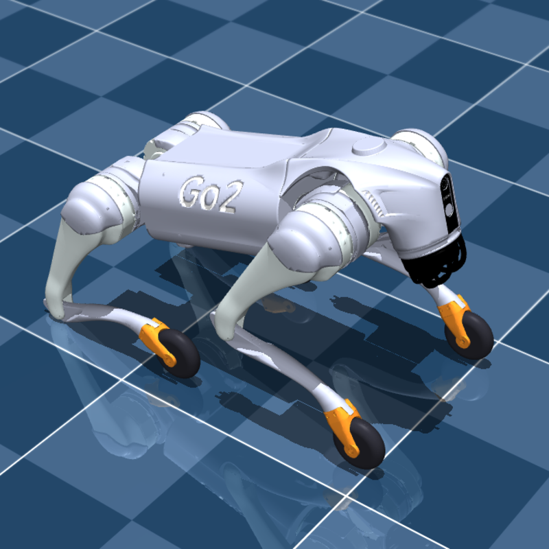
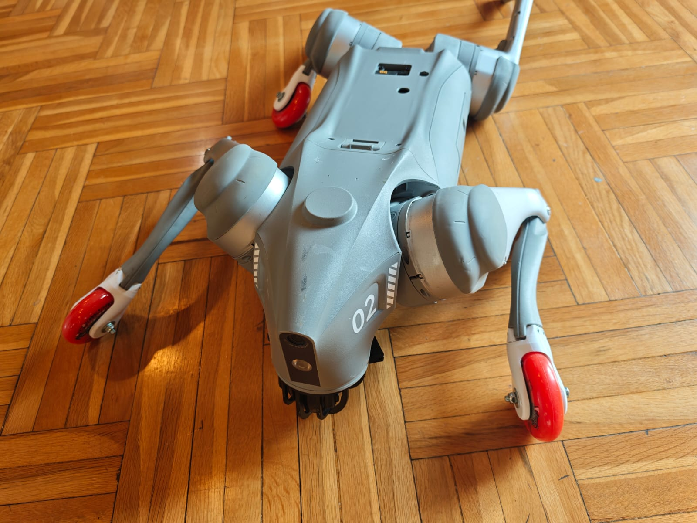
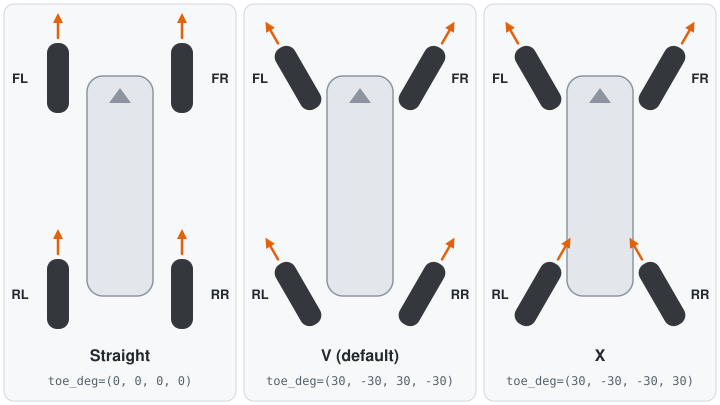
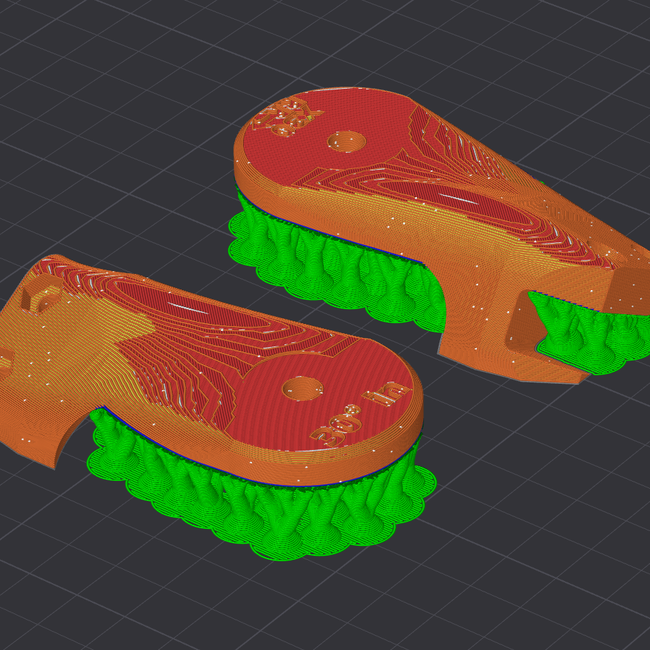

# go2skate

Inline-skate wheel feet for the Unitree Go2: the printed part, and the simulation model generated from it.

<p>
  
  
</p>
<p>
  
</p>

## Generate models

1. Edit `go2skate/config.py` to configure wheels, mass, bearings, axle etc

2. Run the viewer
`uv run python -m ocp_viewer --port 3939` browse to http://localhost:3939/viewer

3. Generate print/ (STL), models/ (STEP), sim/generated/ (MuJoCo)
`uv run go2skate build --show`

You can check the stock foot and a fit-test cup (print/cup_fit_test.stl)
`uv run go2skate build --stock` 

4. View in MuJoCo
`uv run go2skate view`

## CLI

Change any setting for one build with `--set`, by its dotted name, and write somewhere else with `--out`:

```
uv run go2skate build --set toe_deg=20,-20,20,-20 --set wheel.diameter=72 --set fork.end_r=18 --out builds/72mm
uv run go2skate check --out builds/72mm
```

## Wheel layouts

`toe_deg` in `go2skate/config.py` (or `--set toe_deg=30,-30,-30,30` for one build) turns each wheel about its foot's axis, in the order FL, FR, RL, RR. Positive turns the wheel's front to the robot's left. Seen from above, front up:



## Sim files

The simulation, in `sim/generated/`:

|             |                                                                                                                                                |
|-------------|------------------------------------------------------------------------------------------------------------------------------------------------|
| `scene.xml` | the robot on its wheels, on a floor (`go2skate.xml` without the floor): Menagerie's Go2 with its feet swapped                                  |
| `spec.json` | the same geometry and physics as numbers: each leg's wheel centre and axle in the calf frame, wheel size and tread, masses, inertias, friction |
| `meshes/`   | the visual meshes the MJCF loads                                                                                                               |

Wheels collide as spheres, the fastest; `--set sim.wheel_collision=hull` or `mesh` is more exact but slower.

## Using it from another project

Add it as a dependency:

```
uv add git+https://github.com/leshy/go2skate
```

and build the skate you want into your own tree, from Python:

```python
import go2skate
from go2skate import Skate, Wheel

out = go2skate.build(Skate(toe_deg=(20, -20, 20, -20), wheel=Wheel(diameter=72)), out="assets/go2skate", cad=False)
# out / "sim/generated/scene.xml", out / "sim/generated/spec.json", ...
```

`cad=False` skips the printable parts.

## BOM

For one robot (four wheel feet), with the default config:

| Part               | Spec                                                                             | Qty |
|--------------------|----------------------------------------------------------------------------------|-----|
| Printed wheel foot | `print/wheel_foot_{FL,FR,RL,RR}.stl`, one each (labelled), PETG                  | 4   |
| [Inline-skate wheel](https://duckduckgo.com/?q=inline+skate+wheel&ia=images&iax=images) | **80 mm** diameter, about **24 mm** wide (designed for 24.5)                     | 4   |
| Bearing            | **608** (8 x 22 x 7 mm), shielded: the standard skate bearing, two per wheel     | 8   |
| Bearing spacer     | sits inside the wheel's hub between the two bearings                             | 4   |
| Bearing insert     | 8 to 6 mm reducer, one in each bearing (for the M6 axle)                         | 8   |
| Axle               | **M6 x 50 hex bolt** + M6 nyloc nut: the arms are 38.3 outside to outside, it clamps up to 41.25 (`axle.bolt`, `axle.nut_washers`); wider arms sink the washers. For an 8 mm skate axle or M8 bolt, no inserts: `--set axle.d=8` | 4   |
| Washer             | M6, 18 mm (DIN 9021, `axle.washer_d`), under the head and the nut                | 8   |
| Screw              | M4 x 25 socket cap: two per foot, across through both ears and the calf's tongue | 8   |
| Nut                | M4 hex nut (ISO 4032, 7 mm across flats, 3.2 thick), sunk in the far ear. Or `--set screws.nut=false` for M4 x 4 mm heat-set inserts | 8   |

## Printing

Print the feet split in two (`go2skate build --set split=true`) unless you print them in PPA-CF, PA-CF or something as tough between layers. Standing up in one piece, the layers run across the arms, and in PETG a foot broke cleanly along a layer at the arms' root.

`split=true` cuts each foot along the wheel's middle plane: `print/wheel_foot_{leg}_outer.stl` and `_inner.stl`. Each half lies on its cut face with its arm flat over the bed, so the layers run along the arm. Put support under the arm (it stands ~13 mm off the bed), with an interface layer to keep the bearing's boss clean. The screws are the same: the M4s and the axle cross the cut and clamp the halves together.



The wheel's bottom sits 48.5 mm under the stock foot's: a bigger wheel makes the legs effectively longer still.

